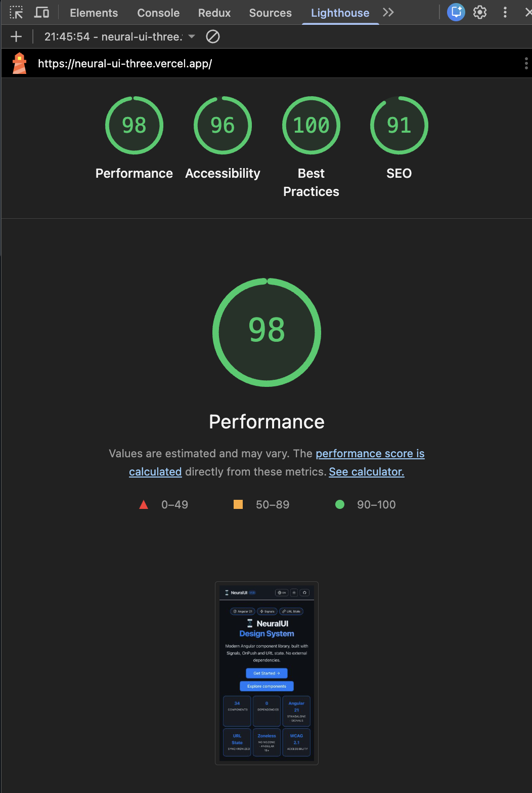

# @neural-ui/core

<p>
  <a href="https://www.npmjs.com/package/@neural-ui/core"></a>
  <a href="https://www.npmjs.com/package/@neural-ui/core"></a>
  
  
  
</p>

Modern Angular UI component library — **signals-first**, fully **standalone**, with dedicated subpath entry points and no Zone.js requirement.

> Live documentation and examples → [neural-ui-showcase.vercel.app](https://neural-ui-showcase.vercel.app/es/home)

> Building a full admin product? Try [Neural Admin Pro](https://neural-ui-admin-pro.vercel.app/login), a premium Angular dashboard template built with Neural UI and ready to connect to your own backend.

<p align="center">
  
</p>

---

## Features

- **104 public entry points** — components, overlays, utilities, styles, schematics and public testing harnesses
- **Signals API** — inputs, outputs and internal state are built with `input()`, `output()`, `signal()`, `computed()` and `effect()`
- **Standalone** — every component is standalone, import only what you need
- **OnPush everywhere** — maximum performance out of the box
- **Accessible by design** — ARIA attributes, keyboard navigation and focus management across the main interactive components
- **Release-gated** — unit, package, compatibility, SSR, accessibility and browser checks run before publication
- **Themeable** — full design token system via CSS custom properties

---

## Quality Snapshot

<!-- neural-ui-metrics:start -->
- **Version:** 1.15.1
- **Entry points:** 104
- **Automated tests:** 3324
- **Coverage:** 98.13% statements · 96.44% branches · 98.61% functions · 98.91% lines
<!-- neural-ui-metrics:end -->

- Signals-first architecture across `ui-core`
- Standalone + OnPush component model
- BEM as the required styling convention for component and demo SCSS
- Zoneless-oriented test setup
- Global coverage above 90% in all main metrics and across covered `ui-core` source files
- Strong accessibility baseline validated in showcase and reinforced in core components

For the current quality checklist and accessibility audit snapshot, see [projects/ui-core/QUALITY_STATUS.md](projects/ui-core/QUALITY_STATUS.md).

---

## Installation

```bash
npm install @neural-ui/core @angular/cdk @ng-icons/core @ng-icons/lucide apexcharts ng-apexcharts
```

---

## Setup

Automated setup is additive and idempotent:

```bash
ng add @neural-ui/core
ng generate @neural-ui/core:theme --density=comfortable --theme=high-contrast
ng generate @neural-ui/core:layout app-shell
ng generate @neural-ui/core:dashboard sales
ng generate @neural-ui/core:crud-page customers
```

`ng add` preserves existing providers and styles. Re-running any command is safe; generated files are not replaced unless `--force` is supplied. Use `--skip-styles` to keep style registration manual.

La configuración automática es aditiva e idempotente: conserva providers y estilos existentes. Los archivos generados no se sustituyen salvo que se use `--force`; `--skip-styles` mantiene el registro de estilos manual.

| Schematic                | Public options / Opciones públicas                                                                          | Result / Resultado                                                                                                                                                                           | Revert / Reversión                                                                                                                                                                 |
| ------------------------ | ----------------------------------------------------------------------------------------------------------- | -------------------------------------------------------------------------------------------------------------------------------------------------------------------------------------------- | ---------------------------------------------------------------------------------------------------------------------------------------------------------------------------------- |
| `ng add @neural-ui/core` | `--project`, `--skip-styles`                                                                                | Adds `provideNeuralUI()` and `node_modules/@neural-ui/core/styles.scss` without removing existing providers or styles. / Añade el provider y el estilo sin eliminar configuración existente. | Remove only the provider and style entry added by the command. / Elimina únicamente el provider y la entrada de estilo añadidos.                                                   |
| `:theme [name]`          | `--name`, `--path`, `--density=compact\|comfortable\|spacious`, `--theme=default\|high-contrast`, `--force` | Creates `[path]/[name].scss`; defaults to `src/styles/neural-ui-theme.scss`. / Crea el preset SCSS en la ruta elegida.                                                                       | Delete the generated file and any import or `data-neu-*` attributes you added. / Elimina el archivo y los imports o atributos añadidos.                                            |
| `:layout NAME`           | `--project`, `--path`, `--force`                                                                            | Creates `NAME.component.ts`, `.html` and `.scss` with a mobile-first sidebar/toolbar shell.                                                                                                  | Delete the generated directory and any route you added; existing routes are not modified automatically. / Elimina el directorio y la ruta añadida; no se alteran rutas existentes. |
| `:dashboard NAME`        | `--project`, `--path`, `--force`                                                                            | Creates the three component files with responsive metric/card foundations. / Genera una base responsive de métricas y tarjetas.                                                              | Delete the generated directory and its manually added route. / Elimina el directorio y su ruta añadida manualmente.                                                                |
| `:crud-page NAME`        | `--project`, `--path`, `--force`                                                                            | Creates the three component files with Reactive Forms, input, table and actions. / Genera una base CRUD con formularios reactivos, input, tabla y acciones.                                  | Delete the generated directory and its manually added route. / Elimina el directorio y su ruta añadida manualmente.                                                                |

Generated page copy is starter content: connect it to the consumer application's translation system before shipping. / Los textos de las páginas generadas son contenido inicial: intégralos con el sistema de traducciones de la aplicación antes de publicar.

Add `provideNeuralUI()` to your `app.config.ts`:

```typescript
import { ApplicationConfig } from '@angular/core';
import { provideRouter } from '@angular/router';
import { provideNeuralUI } from '@neural-ui/core';

export const appConfig: ApplicationConfig = {
  providers: [provideRouter(routes), provideNeuralUI()],
};
```

Import the global stylesheet in your `styles.scss`:

```scss
@use '@neural-ui/core/styles' as *;
```

Component APIs are imported from dedicated subpaths. The package root is reserved for setup utilities such as `provideNeuralUI()`.

```typescript
import { NeuButtonComponent } from '@neural-ui/core/button';
import { NeuInputComponent } from '@neural-ui/core/input';
import { NeuTableComponent } from '@neural-ui/core/table';
import { NeuToastService } from '@neural-ui/core/toast';
```

### Table server query contract

`NeuTableQueryState` is the canonical server-oriented state: 1-based `page`, `pageSize`, `search`, an explicit nullable single `sort`, ordered `sortEntries` for multisort, stable global-filter fields, and complete column filters. Every column filter contains its deterministic `and`/`or` operator plus every ordered typed constraint. Selection, expansion, layout, keyboard focus, and filter drafts are intentionally not query state.

Supplying `[query]` controls all query slices. A UI action emits one immutable `queryChange` proposal and the rendered query stays authoritative until the consumer echoes it; that echo is silent. `query` takes precedence over the sort-specific input and URL restoration/writes. When control is released, active URL, `pageSize`, and sort adapters resume; query slices without an active adapter retain the last authoritative snapshot. Without `query`, existing uncontrolled and URL behavior remains unchanged. `queryChange` is available in both client and server modes. Existing server-only `serverStateChange` consumers remain supported through a compatibility projection derived from the same canonical query; multi-rule filters are not reduced to a misleading first rule in that legacy shape.

`lazyLoadOnInit` is an additive, mount-time opt-in and defaults to `false` for existing Neural consumers. With `serverSide=true`, enabling it emits exactly one initial canonical query after initial inputs, a controlled query, or URL restoration has been applied. Changing `serverSide` or `lazyLoadOnInit` after that initial decision does not trigger a retroactive initial load. Neural pages remain 1-based; the zero-based `first` offset is `(page - 1) * pageSize`.

Custom predicates without `serverSerializer` are marked `local-only`. Select/MultiSelect values that are not transport-safe JSON primitives preserve identity and are marked `requires-consumer` unless a serializer is configured. Serializer exceptions fail fast. JSON-like serializer results are recursively snapshotted and frozen; non-finite numbers, bigint, symbols, functions, cycles, and non-plain objects remain `requires-consumer`. Date-only values use `YYYY-MM-DD`; instants use UTC ISO strings. The query-level `serialization` summary exposes both categories and global accessors without `serverField`.

```html
<neu-table
  [serverSide]="true"
  [lazyLoadOnInit]="true"
  [query]="query()"
  (queryChange)="query.set($event)"
  (serverStateChange)="loadLegacy($event)"
/>
```

### Table selection migration contract

`NeuTable` supports `selectionMode="single"` (radio) and `selectionMode="multiple"` (checkbox). The legacy `[selectable]="true"` input remains an alias for uncontrolled multiple selection. Supply `[selection]` to make only selection controlled; each user action emits one proposed `T[]` through `selectionChange`, and the rendered state changes when the consumer supplies the replacement value. Selection is canonical by `rowKey`, so preselection and immutable row replacement do not depend on object references.

Use `[rowSelectable]="(row, index) => boolean"` to disable row, checkbox and radio interaction. Disabled rows remain selected when already supplied by a consumer but are excluded from header selection. `selectAllScope="page"` changes only the current page; the default `"filtered"` preserves selection across client pages and affects all filtered client rows. Unless `selectAllAriaLabel` is supplied, the header label follows that scope: “Select all rows on this page” or “Select all filtered rows”. In server mode both scopes are limited to loaded rows—full-record server selection is intentionally not claimed.

`rowSelect` and `rowUnselect` emit typed row deltas. `selectAllChange` is one aggregate header event, while the backward-compatible `selectionChange` remains one whole-selection event per action. A single-row replacement deterministically emits `selectionChange`, then `rowUnselect(previous)`, then `rowSelect(next)`; echoing a controlled value emits nothing. Each public event receives its own shallow array copies, and the shallow-frozen `selectedRows()` projection preserves each `T` identity.

Canonical count can exceed resolved rows when selected server records are not loaded. The bar then reports `resolved/canonical selected` (for example `0/1 selected`) and hides row-dependent bulk actions at zero resolved rows; clearing selection remains available and unknown keys are never deleted or represented by fabricated rows. `rowKey` values should be unique. If current data contains duplicates, every row with that key renders selected, while the first current-data occurrence wins the resolved projection. Sorting, filtering, pagination, virtual-window recycling and immutable data replacement never change canonical selected keys. Full roving-focus, keyboard range selection and Shift-range selection remain part of the dedicated keyboard phase.

### Table body composition

`neuTableBody` keeps Neural ownership of the primary row and gives the consumer its cells. `neuTableBodySection` is the advanced full-section escape hatch: it renders directly under `<tbody>` and can emit one managed primary row plus any number of sibling rows. Use `[neuTableManagedRow]="entry"` on the primary `<tr>` to preserve selection, keyboard focus, ARIA, context-menu and reorder behavior. If both body templates are present, the section template wins. `[neuTableBodySectionOf]="rows"` optionally anchors exact strict-template row typing. Variable-height sibling rows are intentionally restricted to non-virtual mode; virtual contexts expose `siblingRowsSupported=false`.

```html
<neu-table
  [data]="users"
  [columns]="columns"
  rowKey="id"
  selectionMode="multiple"
  [selection]="selectedUsers"
  [rowSelectable]="canSelectUser"
  selectAllScope="page"
  (selectionChange)="selectedUsers = $event"
  (rowSelect)="onUserSelected($event)"
/>
```

### Density and high contrast / Densidad y alto contraste

The current appearance remains the default. Opt in on `<html>` or a scoped shell:

```html
<html data-neu-density="compact" data-neu-theme="high-contrast"></html>
```

Available densities are `compact`, `comfortable`, and `spacious`. Remove the attributes to revert instantly to the existing default. / Las densidades disponibles son `compact`, `comfortable` y `spacious`. Elimina los atributos para volver al aspecto actual.

### Public testing API / API pública de testing

```typescript
import { TestbedHarnessEnvironment } from '@angular/cdk/testing/testbed';
import { NeuInputHarness } from '@neural-ui/core/testing';

const loader = TestbedHarnessEnvironment.loader(fixture);
const input = await loader.getHarness(NeuInputHarness);
await input.setValue('Ada');
```

Harnesses are available for button, input, checkbox, switch, select, date input, table and dialog. / Hay harnesses para button, input, checkbox, switch, select, date input, table y dialog.

---

## Usage

Import any component directly into your standalone component:

```typescript
import { FormControl, ReactiveFormsModule } from '@angular/forms';
import { NeuButtonComponent } from '@neural-ui/core/button';
import { NeuInputComponent } from '@neural-ui/core/input';

@Component({
  imports: [NeuButtonComponent, NeuInputComponent, ReactiveFormsModule],
  template: `
    <neu-input label="Email" type="email" [formControl]="email" />
    <neu-button variant="primary" (click)="submit()">Send</neu-button>
  `,
})
export class LoginComponent {
  email = new FormControl('');
}
```

---

## Components

Representative entry points:

- **Forms**: `@neural-ui/core/input`, `@neural-ui/core/select`, `@neural-ui/core/multiselect`, `@neural-ui/core/autocomplete`, `@neural-ui/core/input-tags`, `@neural-ui/core/date-input`, `@neural-ui/core/number-input`, `@neural-ui/core/input-otp`
- **Navigation and layout**: `@neural-ui/core/tabs`, `@neural-ui/core/nav`, `@neural-ui/core/sidebar`, `@neural-ui/core/menu`, `@neural-ui/core/dock`, `@neural-ui/core/speed-dial`, `@neural-ui/core/mega-menu`, `@neural-ui/core/accordion`, `@neural-ui/core/toolbar`, `@neural-ui/core/dashboard-grid`
- **Data and overlays**: `@neural-ui/core/table`, `@neural-ui/core/tree`, `@neural-ui/core/tree-table`, `@neural-ui/core/modal`, `@neural-ui/core/popover`, `@neural-ui/core/context-menu`, `@neural-ui/core/command-palette`, `@neural-ui/core/virtual-list`, `@neural-ui/core/confirm-dialog`
- **Rich data display**: `@neural-ui/core/kanban`, `@neural-ui/core/timeline-grid`, `@neural-ui/core/image-gallery`, `@neural-ui/core/uploader`
- **Feedback and utilities**: `@neural-ui/core/alert`, `@neural-ui/core/toast`, `@neural-ui/core/tooltip`, `@neural-ui/core/block-ui`, `@neural-ui/core/url-state`
- **Visualization and display**: `@neural-ui/core/chart`, `@neural-ui/core/compare`, `@neural-ui/core/stats-card`, `@neural-ui/core/timeline`, `@neural-ui/core/timeline-grid`, `@neural-ui/core/scheduler-gantt`, `@neural-ui/core/meter-group`, `@neural-ui/core/knob`

For the complete catalog, examples, and API tables, use the live docs at [neural-ui-showcase.vercel.app](https://neural-ui-showcase.vercel.app/es/home).

---

## Neural Admin Pro

Build production-ready SaaS dashboards, CRM tools, internal business apps and client portals with Neural Admin Pro, a premium Angular dashboard template built with Neural UI.

Neural Admin Pro is a full-stack Angular and NestJS product with PostgreSQL, authentication, roles, workspaces and a public static demo. Its source can also be adapted to another backend when required.

- [Live demo](https://neural-ui-admin-pro.vercel.app/login)
- [Buy on Gumroad](https://trujillopete.gumroad.com/l/epbrur)
- [Buy on Payhip](https://payhip.com/b/0apB6)
- [Buy on Lemon Squeezy](https://pedromorenostordeve.lemonsqueezy.com/checkout/buy/52e743fd-bb93-4ce7-ae17-c8bf2718de3c)

## Peer dependencies

| Package            | Required version   |
| ------------------ | ------------------ |
| `@angular/core`    | `>=19.0.0 <23.0.0` |
| `@angular/cdk`     | `>=19.0.0 <23.0.0` |
| `@angular/common`  | `>=19.0.0 <23.0.0` |
| `@angular/forms`   | `>=19.0.0 <23.0.0` |
| `@angular/router`  | `>=19.0.0 <23.0.0` |
| `@ng-icons/core`   | `>=31.4.0 <34.0.0` |
| `@ng-icons/lucide` | `>=31.4.0 <34.0.0` |
| `apexcharts`       | `>=4.0.0 <6.0.0`   |
| `ng-apexcharts`    | `>=1.15.0 <3.0.0`  |

For Angular 19 projects, use `ng-apexcharts@1.15.x` with `apexcharts@4.x` or newer. Angular 20+ projects can use the newer `ng-apexcharts@2.x` line.

---

## Contributing

1. Fork the repository and create a feature branch
2. Run `npm install`
3. Run tests: `npm test`
4. Run the release gate: `npm run verify:release`
5. Open a pull request

---

## Known issues & workarounds

### Angular 20.x — npm peer resolution on install

**Affected versions:** Angular 20.x projects with mixed Angular/CDK minors  
**Symptom:** `npm install` may fail with `ERESOLVE` or peer dependency conflicts while installing `@neural-ui/core` and its required peers.

**Root cause:** Angular 20.x is supported, but installation can fail when `@angular/*` packages and `@angular/cdk` are not aligned to the same minor version in the host app.

**Solution — align Angular packages before installing:**

Make sure all Angular packages, especially `@angular/cdk`, use the same 20.x minor in your app, then reinstall dependencies.

```bash
npm install @angular/core@20.x @angular/common@20.x @angular/forms@20.x @angular/router@20.x @angular/cdk@20.x
npm install @neural-ui/core @ng-icons/core @ng-icons/lucide apexcharts ng-apexcharts
```

### Angular 21.2.x — NG3004 with `FormsModule`

**Affected versions:** Angular 21.2.0 – 21.2.7  
**Symptom:** Using `FormsModule` (even standalone imports) in any component causes the build error:

```
NG3004: NeuXxx is not a known element... ɵNgNoValidate is not exported from the types definition file
```

**Root cause:** `ɵNgNoValidate` is accidentally not `export`ed from `@angular/forms/types/forms.d.ts` in those patch releases.

**Solution — use `ReactiveFormsModule` + `FormControl`:**

Replace every template-driven value binding with a `FormControl` + `[formControl]` directive:

```typescript
// Before (triggers NG3004)
import { FormsModule } from '@angular/forms';
// ...
imports: ([FormsModule],
  // ...
  (isChecked = false));
```

```typescript
// After (works correctly)
import { FormControl, ReactiveFormsModule } from '@angular/forms';
// ...
imports: [ReactiveFormsModule],
// ...
readonly isChecked = new FormControl(false, { nonNullable: true });
```

```html
<!-- Before -->
<neu-checkbox [value]="isChecked" (valueChange)="isChecked = $event" label="Accept" />

<!-- After -->
<neu-checkbox [formControl]="isChecked" label="Accept" />
```

All NeuralUI form components implement `ControlValueAccessor` (`NG_VALUE_ACCESSOR`) and work with both binding strategies. Prefer `ReactiveFormsModule` for Angular 21+.

---

## License

Neural UI was created and is maintained by [Pedro Moreno Trujillo](https://github.com/PedroMorenoTrujillo).

Copyright © 2026 Pedro Moreno Trujillo. Released under the MIT License.
